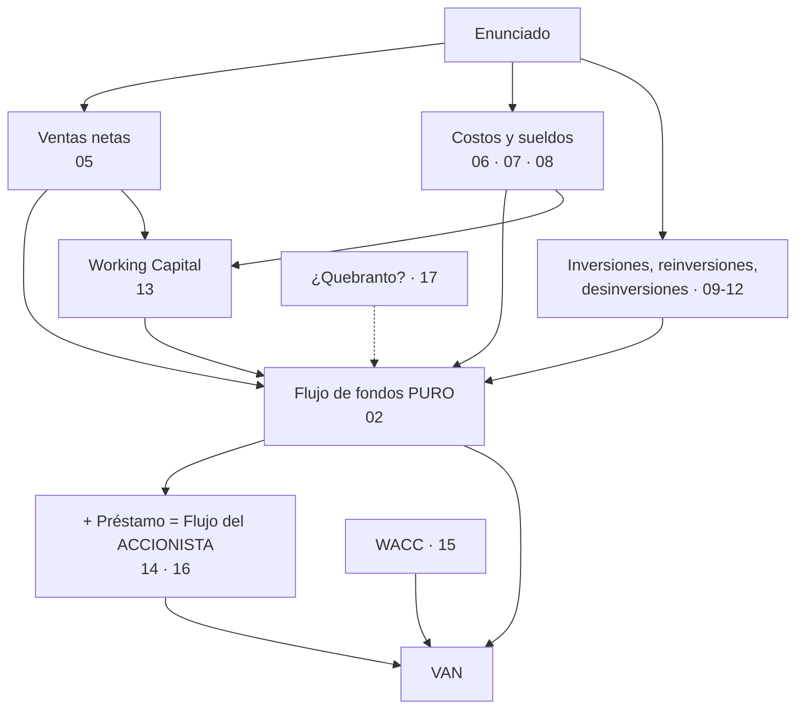

# Sistemas de Gestión — Flujo de Fondos desde cero

Apunte para preparar el parcial / recuperatorio de **Sistemas de Gestión (UTN FRBA, cátedra Grandoso)**.
Está armado **en orden incremental**: cada nota usa lo de las anteriores. Si es la primera vez, leelo en orden.

> [!important] Fuente de verdad
> Todo sale de la **Guía de Ejercicios V1.7**, las **clases grabadas** y la **planilla/resumen de un compañero**. No hay nada sacado de internet.
> Cuando las fuentes no coinciden, manda **el criterio de Grandoso en clase** y el caso queda marcado con un callout **⚠️ Consultar**. Todos esos casos están juntos en [[Dudas abiertas para consultar]].

---

## Recorrido de estudio

### Parte 1 — Fundamentos
1. [[01 Proyecto y flujo incremental]]: qué entra y qué no entra en un flujo (incremental, hundido, costo de oportunidad).
2. [[02 Estructura del flujo de fondos]]: el **template** IAI / EAI / GND / IIGG / INAI / ENAI / Ajustes.
3. [[03 Tasas de interés]]: TNA, TEA, capitalización y cómo pasar cualquier tasa a anual.
4. [[04 VAN, TIR y Payback]]: cómo se decide con el flujo terminado.

### Parte 2 — Ingresos y costos
5. [[05 Ventas, IIBB e IVA]]: de venta bruta a venta neta, regalías, comisiones e IVA.
6. [[06 Costos, producción y stock]]: variables/fijos, directos/indirectos, vendido vs producido, desperdicio.
7. [[07 Precio - markup, margen, equilibrio y elasticidad]]
8. [[08 Sueldos, indemnizaciones y ahorros]]

### Parte 3 — Inversiones
9. [[09 Inversión inicial y depreciación]]
10. [[10 Venta de activos y valor residual]]
11. [[11 Reinversión y desinversión]]: el tema que le faltaba al resumen.
12. [[12 Capacidad - cuándo comprar la máquina o stockear]]

### Parte 4 — Capital de trabajo
13. [[13 Capital de trabajo (Working Capital)]]: métodos, variaciones y recupero.

### Parte 5 — Financiación y tasa de descuento
14. [[14 Préstamos - francés, alemán, americano y gracia]]
15. [[15 WACC y tasa de descuento]]
16. [[16 VAN puro vs VAN del accionista - apalancamiento]]

### Parte 6 — Impuestos especiales
17. [[17 Quebranto impositivo]]

### Parte 7 — Para el examen
18. [[18 Método paso a paso para el parcial]]
19. [[19 Errores comunes y trampas]]
20. [[20 Ejercicio integrador - Flamingo resuelto]]
21. [[21 Mapa de ejercicios de la guía]]: qué tema practica cada ejercicio.
22. [[Dudas abiertas para consultar]]
    - Extra: [[Estrella (ej 47) - trampas del ejercicio]]
23. [[Glosario]]

---

## Mapa conceptual rápido

## Convenciones del apunte

| Símbolo | Significado |
|---|---|
| **IAI** / **EAI** | Ingresos / Egresos **afectos** a impuestos |
| **GND** | Gastos no desembolsables (depreciación, valor libro, quebranto) |
| **INAI** / **ENAI** | Ingresos / Egresos **no afectos** a impuestos |
| **Bilardista** | Lo que alcanza para el parcial: práctico, seguro, "a ganar". (Jorge lo dice así) |
| **Bielsista** | Lo que harías en la vida real: más fino, no hace falta para el parcial |
| `> [!warning] ⚠️ Consultar` | Las fuentes no coinciden: preguntarle a Grandoso |

> [!tip] Bilardo vs Bielsa
> Jorge separa siempre las dos cosas: *"Bilardo, olvidate. Pero pongamos que vamos a un Bielsa…"*. En este apunte, lo **bilardista** es lo que tenés que saber hacer en el parcial. Lo **bielsista** aparece en callouts aparte, para entender el porqué.

## Fuentes y cómo se citan

| Cita | Qué es |
|---|---|
| **[Guía ej N]** | Guía de Ejercicios con respuestas V1.7 R032026 (Grandoso) |
| **[Clase 25/09]** | Jorge: Bielsa (precios, WC por déficit acumulado, stock) y VAN del accionista |
| **[Consulta 02/10]** | Ayudante (Gonzalo): Flamingo y Toldo Gallego, más una consulta corta sobre Bielsa |
| **[Clase 16/10]** | Jorge, clase de consultas: WC, costo de oportunidad, Kd, terreno, obsolescencia, indemnización, WACC |
| **[Clase 20/10]** | Jorge, clase de consultas: préstamo más largo que el proyecto, desinversión, IVA, markup, quebranto, comisiones |
| **[Clase 23/10]** | Jorge, víspera del parcial: quebranto, gracia, licencias del 51, WC, desinstalación |
| **[Resumen amigo]** | `Resumen_Pro_Tips.md` |
| **[Planilla amigo]** | Resoluciones en la planilla (Template, EJ 1, Calamar, 19, 27, 30, 31, Flamingo, Bielsa, Toldo, 36, 37, 42, 47, 48, 50) |
